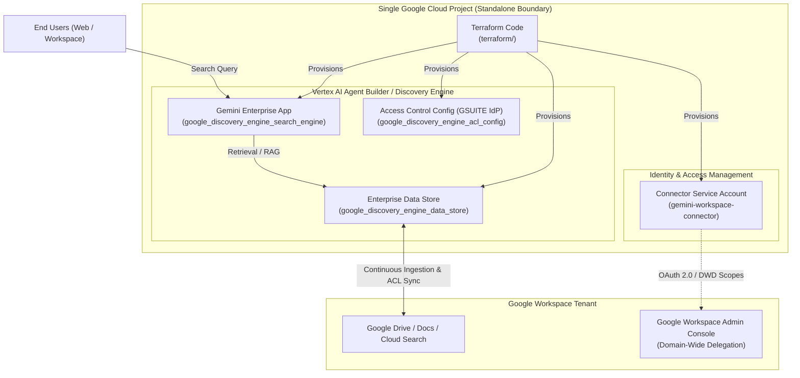

# Gemini Enterprise App with Google Workspace Search

This repository provides Terraform configurations and documentation for deploying a **Gemini Enterprise App** integrated with different type of Connectors (Google Drive, Docs, Slack, Jira).
---

## 🏛️ Standalone Architecture Overview

This project implements a **Standalone Architecture** — a single-project pattern where all components reside within a single Google Cloud project. This provides a straightforward, contained environment without the networking or IAM overhead of cross-project configurations.



For a comprehensive deep dive into the architecture components, data flows, and security model, see the [**docs/architectures/**](docs/architectures/) folder.

---

## 📂 Repository Structure

- **[terraform/](terraform/)**: Terraform configuration and submodules for Discovery Engine, Workspace data stores, third-party connectors, and Cloud Run MCP services. See [terraform/README.md](terraform/README.md) for variable specifications, inputs/outputs tables, and module layout.
- **[docs/architectures/](docs/architectures/)**: Detailed architectural documentation for the Standalone Architecture pattern, component breakdowns, and ACL synchronization.
- **[agents/](agents/)**: Directory for AI agent runtimes, orchestration engines, and custom integrations.

---

## 🚀 Quick Start

### 1. Provision Infrastructure
Navigate to the `terraform/` directory, set up your configuration, and apply:

```bash
cd terraform
cp terraform.tfvars.example terraform.tfvars
terraform init
terraform apply
```

> For the complete list of input variables, optional SaaS connectors (Slack, Jira, GitHub), and configuration details, see [terraform/README.md](terraform/README.md).

### 2. Configure Google Workspace Domain-Wide Delegation (DWD)
Authorize the connector service account in the [Google Workspace Admin Console](https://admin.google.com):
1. Retrieve the OAuth client ID:
   ```bash
   terraform output connector_service_account_unique_id
   ```
2. In Google Workspace Admin Console, navigate to: **Security > Access and data control > API controls > Manage Domain Wide Delegation**.
3. Add a new API client with the client ID and the following comma-separated scopes:
   ```text
   https://www.googleapis.com/auth/drive.readonly, https://www.googleapis.com/auth/cloud_search.query, https://www.googleapis.com/auth/admin.directory.user.readonly, https://www.googleapis.com/auth/admin.directory.group.readonly, https://www.googleapis.com/auth/directory.readonly
   ```

---

## 🛡️ Security Notes

- **Dynamic Access Controls**: Document permissions are evaluated at search query time, ensuring users only retrieve documents they have rights to in Google Workspace.
- **Secret & Credential Isolation**: Service account keys and local `.tfvars` are excluded from version control via [.gitignore](.gitignore).
