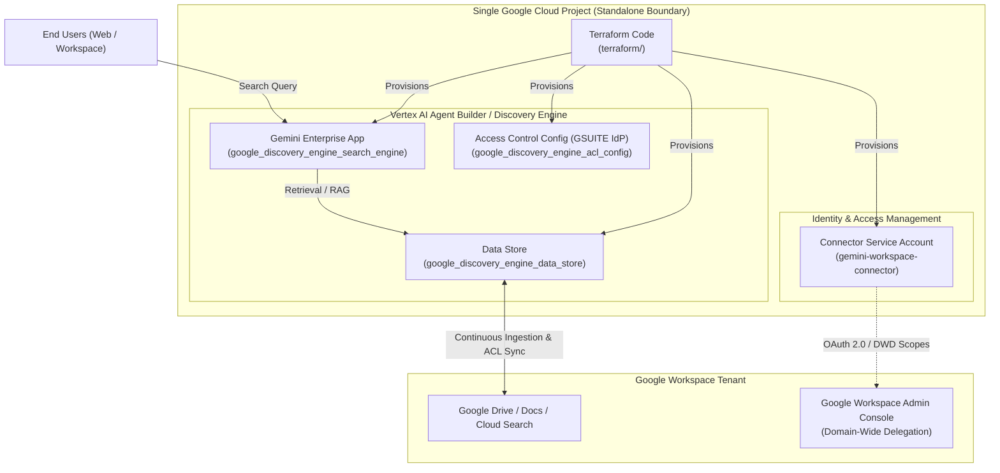

# Standalone Architecture: Gemini Enterprise App

The **Standalone Architecture** is a single-project design for deploying a **Gemini Enterprise App** integrated with Google Workspace. In this model, all application layers, ingestion data stores, search engines, connector identities, and access control policies reside within **a single Google Cloud project**.

The Terraform code in this repository ([`terraform/`](../../terraform/)) implements this single-project pattern.

---

## 🏛️ Topology Diagram

---

## 🔑 Key Architectural Components

### 1. Gemini Enterprise Engine (`google_discovery_engine_search_engine`)
- Configured as an intranet conversational search application (`APP_TYPE_INTRANET`).
- Enables `SEARCH_ADD_ON_LLM` and the Enterprise Search edition for generative summarization, citations, and multi-turn conversational responses.

### 2. Enterprise Data Store (`google_discovery_engine_data_store`)
- Configured for unstructured data (`CONTENT_REQUIRED`) with indexing of Google Workspace artifacts.
- Synchronizes document metadata and permissions.

### 3. Identity and Access Control (`google_discovery_engine_acl_config`)
- Binds Discovery Engine directly to Google Workspace Identity (`GSUITE` IdP).
- Enforces user-level document Access Control Lists (ACLs) dynamically at query time: a user searching through Gemini Enterprise will only retrieve documents and passages they have explicit permission to view in Google Drive.

### 4. Least-Privilege Connector Service Account
- A dedicated service account (`gemini-workspace-connector`) provisioned with minimal roles:
  - `roles/discoveryengine.editor` (to register and sync data store sources).
  - `roles/secretmanager.secretAccessor` (for credentials if custom connector keys are utilized).
- Configured with Google Workspace Domain-Wide Delegation (DWD) to read Drive, Cloud Search, and Directory group memberships without user credentials.

---

## ⚖️ Architectural Characteristics

### Strengths
- **Zero Cross-Project Overhead:** No cross-project IAM service agent bindings, no cross-project service networking, no VPC peering, and no Agent Gateway configurations.
- **Fast Setup:** Simple deployment using Terraform (`terraform apply`).
- **Simpler Attribution & Auditing:** All compute, storage, search queries, and Cloud Logging entries reside under a single GCP billing account and project ID.
- **Unified Identity Boundary:** End-user authorization and administrator roles are contained within a single GCP IAM perimeter.

---

## 🛠️ Mapping to This Repository's Codebase

The Standalone Architecture pattern is implemented by the example files in this repository:

| Architectural Component | Terraform File | Resource / Purpose |
| :--- | :--- | :--- |
| **Data Store** | [`terraform/main.tf`](../../terraform/main.tf) | `google_discovery_engine_data_store.workspace_data_store` |
| **Search Engine App** | [`terraform/modules/app/main.tf`](../../terraform/modules/app/main.tf) | `google_discovery_engine_search_engine.gemini_app` |
| **Workspace IdP ACL** | [`terraform/main.tf`](../../terraform/main.tf) | `google_discovery_engine_acl_config.gsuite_acl` |
| **Connector Identity** | [`terraform/main.tf`](../../terraform/main.tf) | `google_service_account.connector_sa` |
| **IAM Policy Bindings** | [`terraform/main.tf`](../../terraform/main.tf) | `google_project_iam_member.connector_roles` |
| **Outputs & DWD Info** | [`terraform/outputs.tf`](../../terraform/outputs.tf) | Service Account Client ID, App Engine IDs, and console links |

For deployment instructions, see the [Terraform Deployment Guide](../../terraform/README.md).
